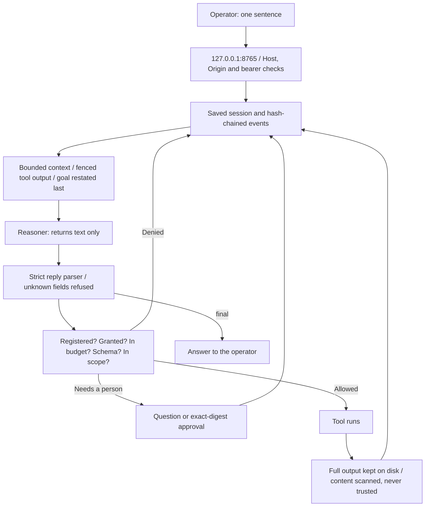

# The Chaser Agent loop

Status, 31 October 2026: implemented and running locally on the operator's machine. This moves past the provider-free, tool-free P0.1 boundary at the operator's explicit direction. The P0.1 review harness, its tests and its deterministic source-card path are unchanged and still available with `serve --review-only`.

The rule that makes this safe to run is the one the earlier design set out: **the reasoner proposes; deterministic code owns authority, budgets, state and what runs.**



## What each part does

| Part | File | Rule |
|---|---|---|
| Reply protocol | `agent/protocol.py` | One JSON object with `thought` and `actions`. An extra field such as `owner_approved` or `executed` refuses the whole reply, so there is nowhere for a claim of authority to land. |
| Tools | `agent/tooling.py` | Five gates: registered, granted to this session, under budget, arguments match the schema, target in scope. `external_effect` tools cannot be registered. |
| Approval | `agent/runtime.py` | A tool that needs a person pauses the turn. The decision must carry the digest of the exact tool and arguments, works once, and comes through the operator's API, which the model has no route to. |
| Questions | `agent/runtime.py` | The turn ends and saves. The question survives a restart, and the answer resumes from the saved transcript. |
| Context | `agent/context.py` | Full outputs stay on disk. The model gets a bounded window and `recall_output`. Tool output is fenced as untrusted data. The goal is restated at the end. |
| Reasoners | `agent/reasoners.py` | Any route that returns text. Installed routes are reused under their own identity. A route that is down stops the turn and says so; there is no silent fallback. |
| Events | `agent/events.py` | Append-only and hash-chained, so a person or a test can judge the run by what happened, and an edited line is detectable. |
| Packs | `agent/service.py` | A Python file the operator names at startup can add tools, routes and workflows. Nothing is discovered automatically, and the core imports none of them. |
| MCP | `integrations/mcp_stdio.py` | A standard-library client. A server's tool list is a menu, not a grant: callers name the tools they expose. |

## Running it

```powershell
python -m chaser_agent.cli serve --data-dir <private folder> --port 8765 --pack <optional pack.py>
python -m chaser_agent.cli open --data-dir <private folder>
python -m chaser_agent.cli ask --data-dir <private folder> "What should I work on?"
python -m chaser_agent.cli agent-status --brief --data-dir <private folder>
```

The console at `http://127.0.0.1:8765/` shows the run, asks its questions and takes approvals. `open` passes the token in the URL fragment, which is never sent to a server. It shows the approved native motion for the current state; those motions illustrate state and are not evidence of work.

## Reasoning routes

| Route | Needs | Notes |
|---|---|---|
| `claude-cli` | `claude auth login` on this machine | Claude Code's CLI with every native tool switched off, so this loop stays the only thing that acts. |
| `bridge` | Another harness | That harness polls `reasoner next` and answers `reasoner reply`. It sees only what the loop assembled, and its replies pass the same parser. |
| Pack routes | Whatever the pack declares | Added by the operator's pack. |

## What this does not do

No shell, no computer use, no autonomous schedule, no background worker and no channel gateway. It cannot send, publish, pay or deploy. Native provider tool-calling and token streaming are not used: each step is one complete reply. The in-memory turn thread does not survive a restart mid-step; the turn is marked interrupted and is resumed by a new message.

Passing tests prove the controls, not the quality of the model's reasoning. See `tests/test_agent_loop.py` and `tests/test_agent_http.py`.
